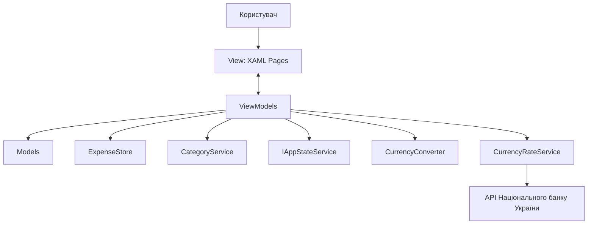
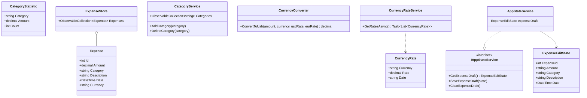
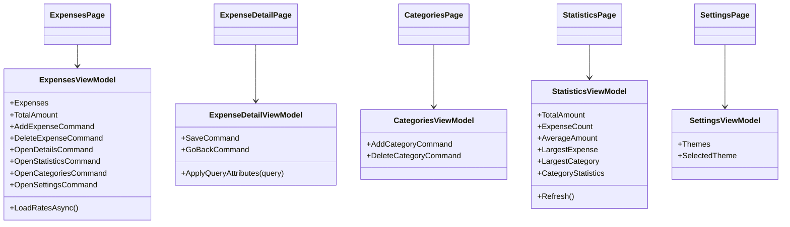
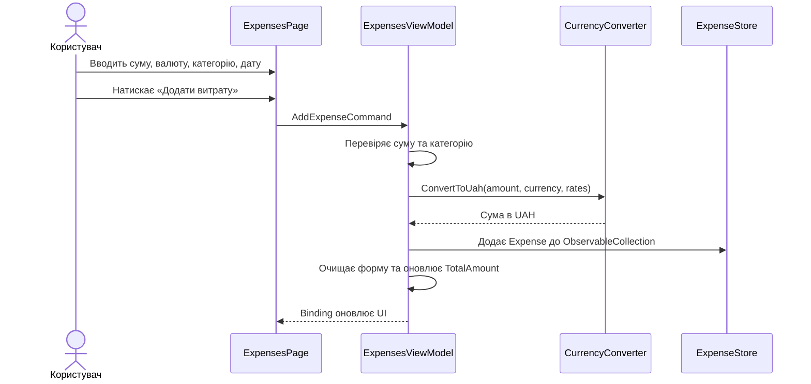
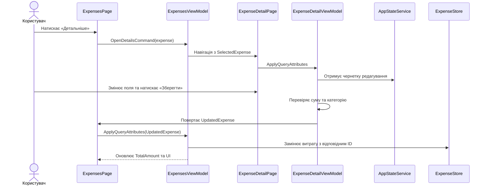
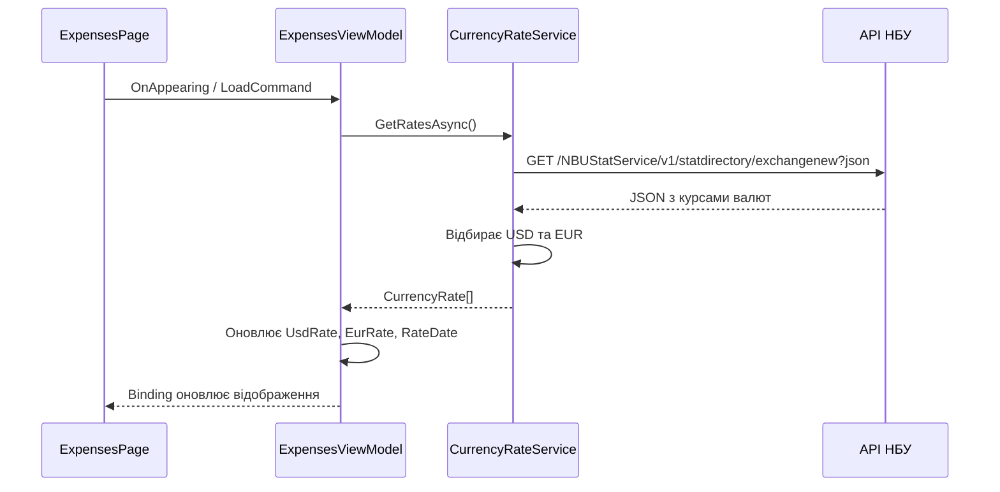
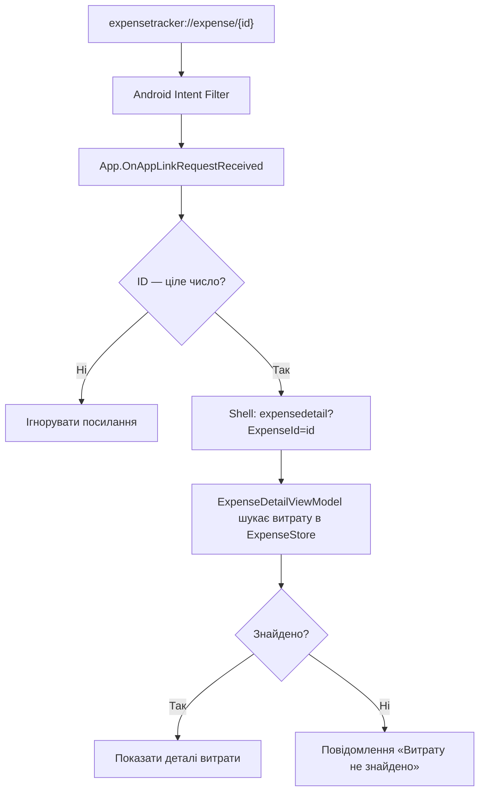

# Expense Tracker

Мобільний застосунок для обліку особистих витрат на **C# / .NET MAUI** з архітектурою **MVVM**. Проєкт містить основний список витрат, редагування деталей, категорії, статистику, налаштування теми та відкриття витрати через deep link.

## Можливості

- Додавання витрат із сумою, категорією, описом і датою.
- Валюти введення: UAH, USD та EUR. USD/EUR конвертуються у гривню за курсами, отриманими з API НБУ.
- Перегляд загальної суми та історії витрат; видалення витрат.
- Перегляд і редагування деталей уже створеної витрати.
- Тимчасове збереження чернетки редагування під час переходів між сторінками.
- Керування категоріями: додавання та видалення.
- Статистика: загальна сума, кількість витрат, середня та найбільша витрата, категорія з найбільшою сумою, підсумки за категоріями.
- Налаштування системної, світлої або темної теми з запам’ятовуванням вибору через `Preferences`.
- Android deep link для відкриття конкретної витрати за ID.

## Технології

- C#, .NET MAUI, XAML
- MVVM (`INotifyPropertyChanged`, `ICommand`, data binding)
- `ObservableCollection<T>` для списків, що оновлюються в UI
- REST API НБУ та `System.Net.Http.Json`
- .NET MAUI Shell navigation і `IQueryAttributable`
- `Preferences` для збереження теми

Версія цільового фреймворку в проєктному файлі — .NET 10 (`net10.0-android`, а також iOS, Mac Catalyst і Windows залежно від ОС, на якій виконується збірка).

## Структура проєкту

```text
Lab1/
├── Models/
│   ├── CategoryStatistic.cs
│   ├── CurrencyRate.cs
│   ├── Expense.cs
│   └── ExpenseEditState.cs
├── Services/
│   ├── AppStateService.cs
│   ├── CategoryService.cs
│   ├── CurrencyConverter.cs
│   ├── CurrencyRateService.cs
│   ├── ExpenseStore.cs
│   └── IAppStateService.cs
├── View/
│   ├── CategoriesPage.xaml(.cs)
│   ├── ExpenseDetailPage.xaml(.cs)
│   ├── ExpensesPage.xaml(.cs)
│   ├── SettingsPage.xaml(.cs)
│   └── StatisticsPage.xaml(.cs)
├── ViewModels/
│   ├── CategoriesViewModel.cs
│   ├── ExpenseDetailViewModel.cs
│   ├── ExpensesViewModel.cs
│   ├── SettingsViewModel.cs
│   └── StatisticsViewModel.cs
├── Platforms/
│   └── Android/MainActivity.cs, AndroidManifest.xml, ...
├── App.xaml(.cs)
├── AppShell.xaml(.cs)
├── MauiProgram.cs
└── Lab1.csproj
```

## Архітектура

Застосунок використовує MVVM. XAML-сторінки відображають стан ViewModel через bindings і передають дії через команди. Сервіси містять логіку роботи зі списком витрат, категоріями, конвертацією валют і чернеткою редагування.



## UML: діаграма класів домену та сервісів



## UML: ViewModel та сторінки



## UML: додавання витрати



## UML: редагування деталей витрати



## UML: отримання курсів валют



## UML: обробка deep link



На Android у `MainActivity` зареєстрована схема `expensetracker` та host `expense`. Приклад посилання: `expensetracker://expense/1`. Воно відкриває деталі витрати з ID `1`, якщо така витрата є в поточному `ExpenseStore`.

## Правила роботи з валютами

`CurrencyRateService` запитує курси з API НБУ та відбирає USD і EUR. `CurrencyConverter` переводить введену суму у гривні: для UAH сума не змінюється, для USD та EUR множиться на відповідний курс. `ExpensesViewModel` зберігає у `Expense.Amount` уже конвертовану суму в UAH; поле `Expense.Currency` містить код вибраної валюти. У поточній реалізації це означає, що `Amount` — сума для підсумків у гривнях, а `Currency` — валюта, у якій користувач вводив суму.

Якщо запит курсів завершується помилкою, ViewModel встановлює курси в `0` і показує «Помилка завантаження». Тому додавання витрат у USD/EUR без успішно завантажених курсів може дати некоректну суму; перед використанням цих валют варто переконатися, що курси завантажені.

## Запуск проєкту

1. Встановіть .NET 10 SDK та відповідне навантаження .NET MAUI для вашої платформи.
2. Відкрийте `Lab1.slnx` у сумісній версії Visual Studio або відкрийте `Lab1/Lab1.csproj`.
3. Виберіть цільову платформу та запустіть застосунок на емуляторі або пристрої.
4. Для завантаження курсів валют потрібне підключення до інтернету.

Android deep link для тестування: `expensetracker://expense/1`. Для успішного відкриття витрата з ID `1` має вже бути в пам’яті застосунку.

## Поточні обмеження, виявлені в коді

- `ExpenseStore` зберігає витрати лише в `ObservableCollection` у пам’яті процесу. База даних або файлове постійне сховище не реалізовані, тому після повного перезапуску застосунку список витрат не відновлюється.
- `CategoryService` початково створює фіксований список категорій у пам’яті; додані категорії не зберігаються після перезапуску.
- `AppStateService` зберігає лише одну чернетку редагування в оперативній пам’яті.
- Deep link налаштовано через intent filter в Android `MainActivity`; аналогічне налаштування universal links / URL schemes для iOS, Mac Catalyst або Windows у перевірених файлах не виявлено.
- Deep link шукає витрату лише в поточному `ExpenseStore`, отже не може відкрити запис після холодного запуску, якщо список ще порожній.
- У `ExpenseDetailViewModel.SaveAsync()` значення Amount розбирається через `decimal.TryParse` без явно заданої культури. Поведінка для десяткового роздільника може залежати від регіональних налаштувань пристрою.
- Не знайдено окремого тестового проєкту в архіві.

## API

Курси отримуються з публічного сервісу НБУ: [NBUStatService](https://bank.gov.ua/NBUStatService/v1/statdirectory/exchangenew?json).

## Ліцензія

У наданому архіві окремий файл ліцензії не виявлено.
